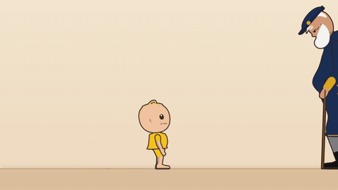
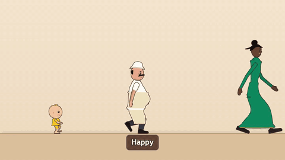
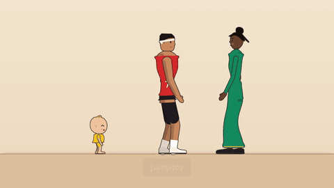

<p align="center"></p>

# CharAI: 2D character animation engine and AI agent skill

CharAI is an open-source 2D character animation engine and agent skill (a Claude Code skill, usable by any agent that can read a skill file and run Node). It is for people and AI agents who want text to animation for human characters: the agent draws any human as a small data file (a skeletal rig skin, SVG paths), directs it with a short `.char` script, and CharAI supplies motion, physics, moods, lip sync and speech, two-character contact and props. Characters only, side view only. Every frame is a pure function of time (`seek(t)`), so any tool with a clock can drive it.

<p align="center">
<a href="#quick-start"></a>
<a href="#gallery"></a>
<a href="#evidence-in-short"></a>
<a href="docs/"></a>
<a href="SKILL.md"></a>
<br>
  
</p>

<p align="center">
<a href="media/cast-lineup.mp4"></a>
<a href="media/toddler-and-captain.mp4"></a>
<a href="media/together.mp4"></a>
</p>

No runtime dependencies: one script file, `dist/char.js`, and a `<char-stage>` web component. Export MP4, transparent WebM and ProRes, PNG sequence, or animated SVG. Scenery is not drawn; the host supplies it.

## The .char script

A film is plain text. This one is complete:

```
film "Hello" 6s
actor Kai = skin kai at 160
0.0 Kai: walk(to=700), face(happy)
2.0 Kai: say("Nice to meet you.", for=2)
```

Each line is a time, an actor and calls such as `walk`, `face`, `say`, `hug`. More single-file examples: [`examples/`](examples/). Full syntax: [`docs/AUTHORING.md`](docs/AUTHORING.md).

## Works with

- **Claude Code and Claude models.** Built with them (see the FAQ). Only Claude models have been tried; any agent that can read a skill file and run Node can use it.
- **Hosts.** Plain HTML pages: tested (`examples/host.html`, `examples/page.html`). Remotion, HyperFrames and GSAP: snippets in [`docs/HOSTS.md`](docs/HOSTS.md), not yet tested.
- **Style libraries** such as Lemo-Opuscar: meant as a character layer beside them. There is no integration code.

## Install as an agent skill

Copy or clone this repository into the agent's skills folder; for Claude Code that is `.claude/skills/charai/`. The agent then reads [`SKILL.md`](SKILL.md), which sends it to one document for each of three jobs: draw a character ([`docs/CHARACTER.md`](docs/CHARACTER.md)), write a film ([`docs/AUTHORING.md`](docs/AUTHORING.md)), add an action ([`docs/ACTIONS.md`](docs/ACTIONS.md)).

## Quick start

Needs Node 18 or newer. For pictures and video, also Chrome or Edge, `npm install` once (`puppeteer-core`), and ffmpeg on the PATH for MP4.

```
node --test tests/*.cjs                       # the test suite
node tools/check.cjs films/demo               # check a film; writes films/demo/index.html
node tools/render.cjs films/demo demo.mp4     # an MP4
```

A character is a skin file: numbers on top of the `mannequin` skin plus a few SVG paths ([`docs/CHARACTER.md`](docs/CHARACTER.md)).

## Evidence in short

Figures from [`docs/EVIDENCE.md`](docs/EVIDENCE.md); each case was run once.

- A character skin: 1.3 to 2.2 KB, about 41,800 tokens and about 40 s each (6 characters, Claude Sonnet).
- An action: about 8,200 tokens and 9 s each (36 actions, all passed the checker).
- A 20 s scene, two characters, moods, 3 own actions: 98,844 tokens, 2.4 minutes.
- Two 30 s episodes against the style-library workflow, both on Sonnet: 425,057 tokens against 667,202, 25 minutes against 74.
- **Where CharAI lost:** a 30 s silhouette film on Opus cost 391,611 tokens and 35.7 minutes against 318,987 and 24.7, and the other film looked better. Not re-run.

## Gallery

<p align="center">
<a href="media/talk-voice.mp4"></a>
<a href="media/gallery-moods.mp4"></a>
<a href="media/gallery-actions.mp4"></a>
</p>

All clips on one page: [`gallery/index.html`](gallery/index.html).

## FAQ

**What is CharAI?**
CharAI is an open-source 2D character animation engine and agent skill. An AI agent or a person draws any human as a small skin data file and directs it with a short `.char` script; the engine supplies skeleton, motion, physics, moods, lip sync, two-character contact and props.

**How do I animate a character with Claude Code?**
Put this repository in `.claude/skills/charai/` and ask Claude Code to draw a character or write a film. It reads `SKILL.md`, follows the document for the job, then loops: write, run the check (`node tools/check.cjs films/x`), look at the picture, fix.

**Does it work with HyperFrames, Remotion or GSAP?**
The frame is a pure function of time (`seek(t)`), the contract those timelines use, and `docs/HOSTS.md` has a snippet for each. Those three snippets are untested; HyperFrames is "snippet provided, not yet tested". Two plain-HTML host examples in `examples/` are tested.

**How does it compare with Lemo-Opuscar?**
Lemo-Opuscar is a style library for code-made films. On two 30 s episodes on Sonnet, CharAI used 425,057 tokens against 667,202; on a 30 s silhouette film on Opus it lost, at 391,611 against 318,987, and looked worse. These are single runs, and CharAI is meant to complement style libraries as their character layer.

**Which models built it?**
It was built with Claude Code. Claude Fable 5.2 was architect and reviewer, Claude Opus 5.5 wrote the engine code, and Claude Sonnet wrote characters, actions, scenes, tools and packaging from the documents alone. Only Claude models have been tried.

**What does it cost in tokens?**
Claude Sonnet wrote a character in about 41,800 tokens, an action in about 8,200, and a 20 s two-character scene in 98,844. Each figure is one run; see `docs/EVIDENCE.md`.

**What can't it do?**
Side view only (no three-quarter or front view), flat cartoon styles, no scenery, no 3D, simple hands, and spring physics for hair and cloth rather than simulation. Lip sync matches the speech but is not polished. Known faults are in `docs/KNOWN-ISSUES.md`.

**Does it need an artist or motion capture?**
No. The agent writes a skin as numbers plus a few SVG paths, and motion comes from the engine's actions, which are a few key poses each. There is no library of ready-made characters; a few worked examples are in `skins/`.

**What licence is it under?**
Apache License 2.0; see `LICENSE` and `NOTICE`. It has no runtime dependencies.

**How do I add a new action?**
Write a small file of key poses in body terms, register it in `CharActions`, and check it with `node tools/actioncheck.cjs actions/x.js`. See it with `node tools/action.cjs x out.png`. The format is in `docs/ACTIONS.md`.

## Limits and status

Known faults: [`docs/KNOWN-ISSUES.md`](docs/KNOWN-ISSUES.md). Agents wrote all of the code; no person has reviewed it line by line yet. Next: three-quarter and front views.

Licence: Apache 2.0, [`LICENSE`](LICENSE), [`NOTICE`](NOTICE).
