<p align="center">
  <picture><source media="(prefers-color-scheme: dark)" srcset="docs/img/header-dark.webp">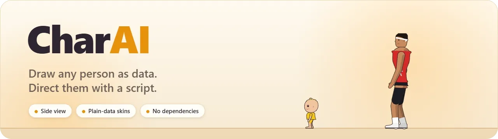</picture>
</p>

<p align="center">
  <a href="#get-started-in-three-steps"><picture><source media="(prefers-color-scheme: dark)" srcset="docs/img/btn-quick-start-dark.svg"></picture></a>
  <a href="#gallery"><picture><source media="(prefers-color-scheme: dark)" srcset="docs/img/btn-gallery-dark.svg"></picture></a>
  <a href="#evidence-in-short"><picture><source media="(prefers-color-scheme: dark)" srcset="docs/img/btn-evidence-dark.svg"></picture></a>
  <a href="docs/"><picture><source media="(prefers-color-scheme: dark)" srcset="docs/img/btn-docs-dark.svg"></picture></a>
  <a href="SKILL.md"><picture><source media="(prefers-color-scheme: dark)" srcset="docs/img/btn-agent-skill-dark.svg"></picture></a>
</p>

<p align="center">
  <a href="LICENSE"><picture><source media="(prefers-color-scheme: dark)" srcset="docs/img/badge-apache-2-dark.svg"></picture></a>
  <picture><source media="(prefers-color-scheme: dark)" srcset="docs/img/badge-side-view-dark.svg"></picture>
  <picture><source media="(prefers-color-scheme: dark)" srcset="docs/img/badge-no-dependencies-dark.svg"></picture>
</p>

# CharAI: 2D character animation engine and AI agent skill

CharAI is an open-source 2D character animation engine and agent skill (a Claude Code skill, usable by any agent that can read a skill file and run Node). It is for people and AI agents who want text to animation for human characters: the agent draws any human as a small data file (a skeletal rig skin, SVG paths), directs it with a short `.char` script, and CharAI supplies motion, physics, moods, lip sync and speech, two-character contact and props. Characters only, side view only. Every frame is a pure function of time (`seek(t)`), so any tool with a clock can drive it. No runtime dependencies: one script file, `dist/char.js`, and a `<char-stage>` web component. Export MP4, transparent WebM and ProRes, PNG sequence, or animated SVG. Scenery is not drawn; the host supplies it.

## Get started in three steps

Needs Node 18 or newer. For pictures and video also Chrome or Edge, and ffmpeg for MP4.

**With Claude Code (the skill).** Only Claude models have been tried.

1. `git clone https://github.com/riponcm/CharAI .claude/skills/charai`
2. `cd .claude/skills/charai && npm install`
3. Ask Claude Code: "Use CharAI to draw a character, a tall grandmother with a silver bun and a green cardigan, and show me her cast sheet."

**By yourself, with the engine.**

1. `git clone https://github.com/riponcm/CharAI && cd CharAI && npm install`
2. `node tools/check.cjs examples/hello.char`
3. `node tools/render.cjs examples/hello.char hello.mp4` and watch eight seconds of a girl walking in and waving.

Your own page, a video editor, making a character, and what to do when a step fails: [`docs/GETTING-STARTED.md`](docs/GETTING-STARTED.md).

<table>
  <tr>
    <td align="center"><picture><source media="(prefers-color-scheme: dark)" srcset="docs/img/feature-any-body-from-numbers-dark.webp">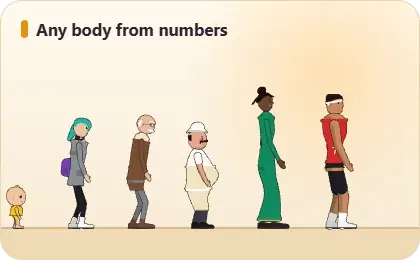</picture></td>
    <td align="center"><picture><source media="(prefers-color-scheme: dark)" srcset="docs/img/feature-physics-that-settles-dark.webp">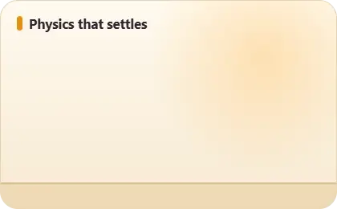</picture></td>
    <td align="center"><picture><source media="(prefers-color-scheme: dark)" srcset="docs/img/feature-moods-change-the-walk-dark.webp">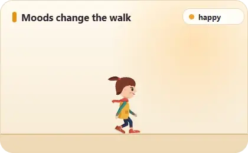</picture></td>
  </tr>
  <tr>
    <td align="center"><picture><source media="(prefers-color-scheme: dark)" srcset="docs/img/feature-speech-and-lip-sync-dark.webp">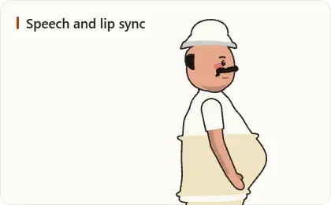</picture></td>
    <td align="center"><picture><source media="(prefers-color-scheme: dark)" srcset="docs/img/feature-characters-that-touch-dark.webp">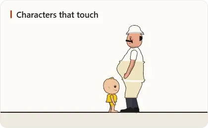</picture></td>
    <td align="center"><picture><source media="(prefers-color-scheme: dark)" srcset="docs/img/feature-one-line-of-script-dark.webp">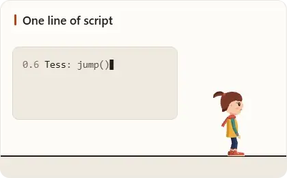</picture></td>
  </tr>
</table>

## The .char script

A film is plain text. This one is complete:

```
film "Hello" 6s
actor Kai = skin kai at 160
0.0 Kai: walk(to=700), face(happy)
2.0 Kai: say("Nice to meet you.", for=2)
```

Each line is a time, an actor and calls such as `walk`, `face`, `say`, `hug`. More single-file examples: [`examples/`](examples/). Full syntax: [`docs/AUTHORING.md`](docs/AUTHORING.md).

## With and without CharAI

"Without" means an agent hand-codes each film; the measured baseline is the Lemo-Opuscar style-library workflow.

| | Without CharAI | With CharAI |
| --- | --- | --- |
| A character | re-coded inside every film | one skin file of 1.3 to 2.2 KB, reused unchanged |
| Two 30-second episodes, Claude Sonnet | 667,202 tokens, 74 minutes | 425,057 tokens, 25 minutes |
| Two 30-second episodes, Claude Opus | 532,368 tokens, 39 minutes | 477,333 tokens, 33 minutes |
| A new action | key poses inside the film's code | a 0.4 to 0.7 KB file, about 8,200 Sonnet tokens |
| On a smaller model | cost more than the larger model | the cheapest run of all |
| Changing one moment | regenerate; the rest may change | edit one script line and render again; only what follows from the edit changes |
| A scenery-rich one-off film (silhouette, Opus) | 318,987 tokens, 24.7 minutes, better-looking | 391,611 tokens, 35.7 minutes: CharAI lost |
| Views and 3D | anything the agent can code | side view only, no 3D |

Single runs; the baseline's setup and the engine's build cost are not counted. Full table, when to use it and when not: [`docs/COMPARISON.md`](docs/COMPARISON.md).

## Works with

- **Claude Code and Claude models.** Built with them (see the FAQ). Only Claude models have been tried; any agent that can read a skill file and run Node can use it.
- **Hosts.** Plain HTML pages: tested (`examples/host.html`, `examples/page.html`). Remotion, HyperFrames and GSAP: snippets in [`docs/HOSTS.md`](docs/HOSTS.md), not yet tested.
- **Style libraries** such as Lemo-Opuscar: meant as a character layer beside them. There is no integration code.
- **As an agent skill:** [`SKILL.md`](SKILL.md) sends the agent to one document for each of three jobs: draw a character ([`docs/CHARACTER.md`](docs/CHARACTER.md)), write a film ([`docs/AUTHORING.md`](docs/AUTHORING.md)), add an action ([`docs/ACTIONS.md`](docs/ACTIONS.md)).

## Evidence in short

Figures from [`docs/EVIDENCE.md`](docs/EVIDENCE.md); each case was run once.

- A character skin: 1.3 to 2.2 KB, about 41,800 tokens and about 40 s each (6 characters, Claude Sonnet).
- An action: about 8,200 tokens and 9 s each (36 actions, all passed the checker).
- A 20 s scene, two characters, moods, 3 own actions: 98,844 tokens, 2.4 minutes.
- Two 30 s episodes against the style-library workflow, both on Sonnet: 425,057 tokens against 667,202, 25 minutes against 74.
- **Where CharAI lost:** a 30 s silhouette film on Opus cost 391,611 tokens and 35.7 minutes against 318,987 and 24.7, and the other film looked better. Not re-run.

## Gallery

Click a preview for the MP4. All clips on one page: [`gallery/index.html`](gallery/index.html).

<p align="center">
<a href="media/cast-lineup.mp4">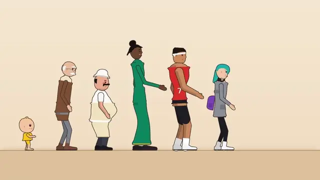</a>
<a href="media/toddler-and-captain.mp4">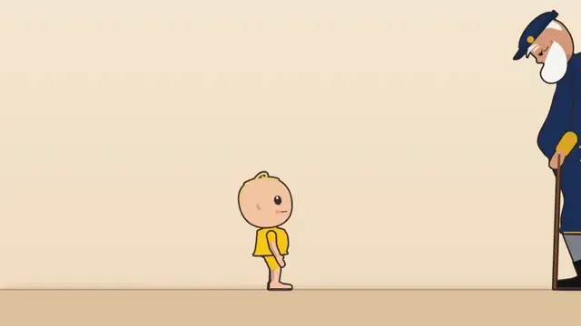</a>
<a href="media/together.mp4">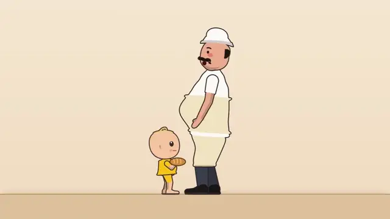</a>
<a href="media/talk-voice.mp4">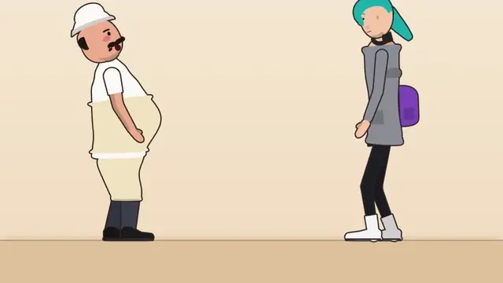</a>
<a href="media/gallery-moods.mp4">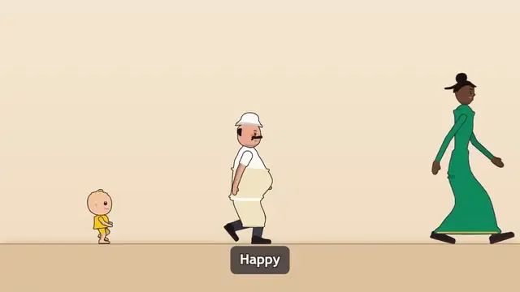</a>
<a href="media/gallery-actions.mp4">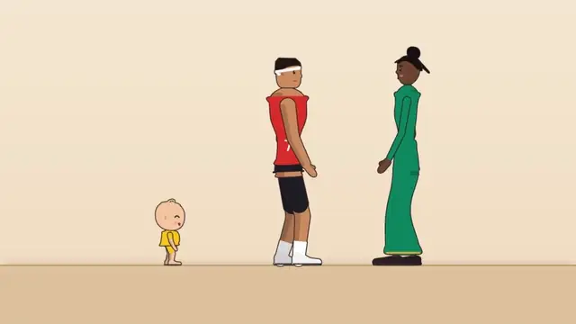</a>
</p>

**From the experiments.** Made with an earlier engine, from the measured tests in the evidence page:

<p align="center">
<a href="media/kai-the-bridge.mp4">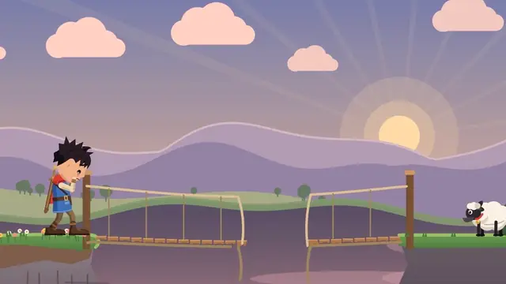</a>
<a href="media/kai-the-cave.mp4">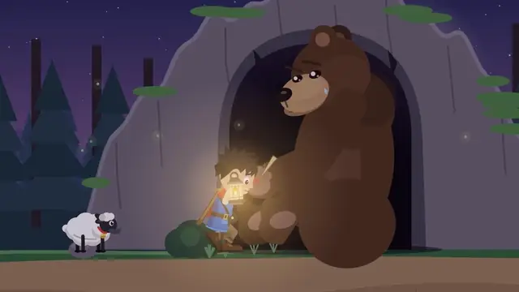</a>
<a href="media/first-jump.mp4">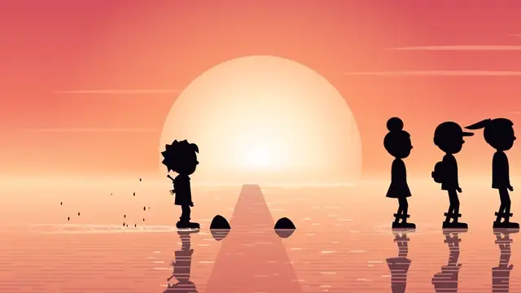</a>
</p>

- **Kai, the bridge:** Claude Sonnet, 203,205 tokens, 10.9 minutes.
- **Kai, the cave:** Claude Sonnet, 221,852 tokens, 13.9 minutes.
- **First Jump:** Claude Opus, 391,611 tokens, 35.7 minutes. CharAI lost this comparison on cost and looks, and it has not been re-run.

## FAQ

**What is CharAI?**
CharAI is an open-source 2D character animation engine and agent skill. An AI agent or a person draws any human as a small skin data file and directs it with a short `.char` script; the engine supplies skeleton, motion, physics, moods, lip sync, two-character contact and props.

**How do I animate a character with Claude Code?**
Put this repository in `.claude/skills/charai/` and ask Claude Code to draw a character or write a film. It reads `SKILL.md`, follows the document for the job, then loops: write, run the check (`node tools/check.cjs films/x`), look at the picture, fix.

**Does it work with HyperFrames, Remotion or GSAP?**
The frame is a pure function of time (`seek(t)`), the contract those timelines use, and `docs/HOSTS.md` has a snippet for each. Those three snippets are untested; HyperFrames is "snippet provided, not yet tested". Two plain-HTML host examples in `examples/` are tested.

**How does it compare with Lemo-Opuscar?**
Lemo-Opuscar is a style library for code-made films. On two 30 s episodes on Sonnet, CharAI used 425,057 tokens against 667,202; on a 30 s silhouette film on Opus it lost, at 391,611 against 318,987, and looked worse. These are single runs, and CharAI is meant to complement style libraries as their character layer.

**Why use CharAI when new models can animate freehand?**
Code-made animation by frontier models is improving fast, but those films are generated from scratch each time, so the cost is paid again for every film and every change, and characters are re-drawn each time. CharAI does the repeated part once, which is what the table above measures. It has been tried only with the Claude models named in the evidence page and has not been compared with any unreleased or newer model (see `docs/COMPARISON.md`, November 2026).

**Which models built it?**
It was built with Claude Code. Claude Fable 5.2 was architect and reviewer, Claude Opus 5.5 wrote the engine code, and Claude Sonnet wrote characters, actions, scenes, tools and packaging from the documents alone. Only Claude models have been tried.

**What does it cost in tokens?**
Claude Sonnet wrote a character in about 41,800 tokens, an action in about 8,200, and a 20 s two-character scene in 98,844. Each figure is one run; see `docs/EVIDENCE.md`.

**What can't it do?**
Side view only (no three-quarter or front view), flat cartoon styles, no scenery, no 3D, simple hands, and spring physics for hair and cloth rather than simulation. Lip sync matches the speech but is not polished. Known faults are in `docs/KNOWN-ISSUES.md`.

**Does it need an artist or motion capture?**
No. The agent writes a skin as numbers plus a few SVG paths, and motion comes from the engine's actions, which are a few key poses each. There is no library of ready-made characters; a few worked examples are in `skins/`.

**What licence is it under?**
Apache License 2.0; see `LICENSE` and `NOTICE`. It has no runtime dependencies.

**How do I add a new action?**
Write a small file of key poses in body terms, register it in `CharActions`, and check it with `node tools/actioncheck.cjs actions/x.js`. See it with `node tools/action.cjs x out.png`. The format is in `docs/ACTIONS.md`.

## Limits and status

Known faults: [`docs/KNOWN-ISSUES.md`](docs/KNOWN-ISSUES.md). Agents wrote all of the code; no person has reviewed it line by line yet. Next: three-quarter and front views.

## Contribute

Draw a character, add an action, write an example film, fix a known issue, or try a host. Start with [`CONTRIBUTING.md`](CONTRIBUTING.md); share what you make in [Discussions](https://github.com/riponcm/CharAI/discussions).

<p align="center">
  <a href="CONTRIBUTING.md"><picture><source media="(prefers-color-scheme: dark)" srcset="docs/img/contribute-dark.webp">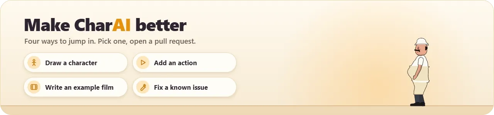</picture></a>
</p>

Licence: Apache 2.0, [`LICENSE`](LICENSE), [`NOTICE`](NOTICE).
