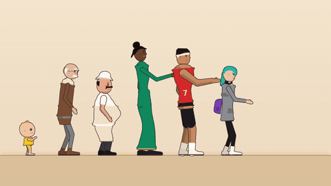
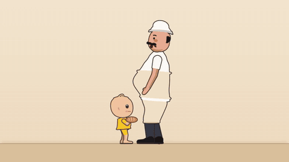
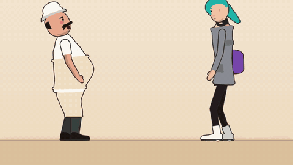

<p align="center"></p>

CharAI is an open-source 2D character animation engine that lets an AI agent draw any human as a small data file and direct them with a short script.

<p align="center">
<a href="#quick-start"></a>
<a href="#gallery"></a>
<a href="#evidence-in-short"></a>
<a href="docs/"></a>
<a href="SKILL.md"></a>
<br>
  
</p>

<p align="center">
<a href="media/cast-lineup.mp4"></a>
<a href="media/toddler-and-captain.mp4"></a>
<a href="media/together.mp4"></a>
</p>

Every frame is a function of time: `seek(t)` in any order gives the same frame, so any tool with a clock can drive it. `Char` is the code prefix (the global `Char`, `Char.mount`, the `<char-stage>` tag, `CharSkins`, `CharActions`); the product is CharAI.

## Who provides what

| Part | Who provides it |
| --- | --- |
| The character's look: body, face, hair, clothes, in any shape | the agent (or you), as a skin file |
| The rules for attaching that drawing to a skeleton | CharAI |
| Motion: walk, run, greet, anger, fight, hug | CharAI |
| Physics: weight, swing and settle of hair and clothes | CharAI |
| Lip sync and expressions | CharAI |
| Two-character contact: hug, handshake, shove, hand over | CharAI |
| The instructions that teach an agent all of this | the skill (`SKILL.md` and `docs/`) |
| Scenery | the host tool (Remotion, HyperFrames, plain HTML), not CharAI |

There is no library of ready-made characters; a few worked examples are in `skins/` and `films/cast/skins/`.

## Evidence in short

Every figure is from [`docs/EVIDENCE.md`](docs/EVIDENCE.md). Each case was run once, with no repeats.

- A character skin file: 1.3 to 2.2 KB, about 41,800 tokens and about 40 s each (6 characters written by Claude Sonnet). The hand-drawn skins before the mannequin were 14 to 16.9 KB.
- An action: about 8,200 tokens and 9 s each, 0.4 to 0.7 KB (36 actions, all passed the action checker).
- A 20 s scene with two characters, moods and 3 own actions: 98,844 tokens, 2.4 minutes.
- Two 30 s episodes against the style-library workflow, both on Sonnet: 425,057 tokens against 667,202, 25 minutes against 74.
- **Where CharAI lost:** a 30 s silhouette film on Opus cost 391,611 tokens and 35.7 minutes against 318,987 and 24.7 (+23% and +44%). The other film also looked better. This comparison was not re-run.
- Building the first release cost Claude Sonnet 1,821,399 tokens and Claude Opus at least 599,403, plus one round that could not be measured. Earlier prototype work cost a further 875,467 and 446,931 Opus tokens.

Full tables, method and what was not measured: [`docs/EVIDENCE.md`](docs/EVIDENCE.md).

## Quick start

Needs Node 18 or newer and, to take pictures or render video, a Chrome or Edge browser. Run `npm install` once for the screenshot and render tools (`puppeteer-core`); MP4 output also needs ffmpeg on the PATH.

```
npm install
node --test tests/*.cjs                       # the test suite
node tools/check.cjs films/demo               # check a film; writes films/demo/index.html
node tools/render.cjs films/demo demo.mp4     # an MP4
```

An agent reads [`SKILL.md`](SKILL.md) and is sent to the right document for one of three jobs.

**Draw a character** ([`docs/CHARACTER.md`](docs/CHARACTER.md), [`docs/RIG.md`](docs/RIG.md)). A person from numbers only:

```js
(function (g) {
  (g.CharSkins = g.CharSkins || {}).nora = { name: 'nora', extends: 'mannequin',
    build: { heads: 7, chest: 0.8, waist: 0.6, hips: 0.85 },
    palette: { suit: '#3f6fa8', hair: '#5a3a28' } };
})(typeof self !== 'undefined' ? self : this);
```

Check it with `node tools/skincheck.cjs skins/nora.js`; see it with `node tools/cast.cjs skins/nora.js nora.png`.

**Write a film** ([`docs/AUTHORING.md`](docs/AUTHORING.md)). A script is plain text:

```
film "Hello" 6s
actor Kai = skin kai at 160
0.0 Kai: walk(to=700), face(happy)
2.0 Kai: say("Nice to meet you.", for=2)
```

**Add an action** ([`docs/ACTIONS.md`](docs/ACTIONS.md)). A few key poses; the engine adds the smooth movement:

```js
(g.CharActions = g.CharActions || {}).bow = {
  channel: 'body', args: { deep: 1 },
  keys: [ { t: 0.4, lean: a => 38 * a.deep, head: 12 }, { t: 1.0, hold: true } ] };
```

Also: pairs, props, speech, and embedding or exporting video and animated SVG ([`docs/HOSTS.md`](docs/HOSTS.md)).

## Gallery

More clips (1280x720 MP4; the talking scene has Windows voices).

<p align="center">
<a href="media/talk-voice.mp4"></a>
<a href="media/gallery-moods.mp4"></a>
<a href="media/gallery-actions.mp4"></a>
</p>

Open [`gallery/index.html`](gallery/index.html) in a browser for all clips on one page.

## Honest limits

- Side view only. Three-quarter and front views are not drawn.
- Flat cartoon styles. No shading, no photographic or painterly looks.
- Physics is believable, not simulated: springs for hair and cloth.
- Hands are simple. No finger-level grips.
- Lip sync from text, or from a timing track, matches the speech but is not polished.
- The Remotion, HyperFrames and GSAP snippets in `docs/HOSTS.md` are untested.
- The evidence is single runs, judged from still frames and strips. Human ratings, films longer than 30 s and a film that reuses existing characters were not measured.
- Known faults are listed in [`docs/KNOWN-ISSUES.md`](docs/KNOWN-ISSUES.md). Agents wrote all of the code; no person has reviewed it line by line yet.

## What is next

Three-quarter and front views.

## Licence

Apache License 2.0, see [`LICENSE`](LICENSE) and [`NOTICE`](NOTICE).
