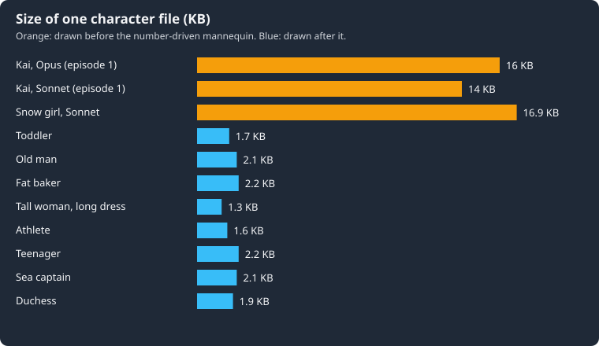
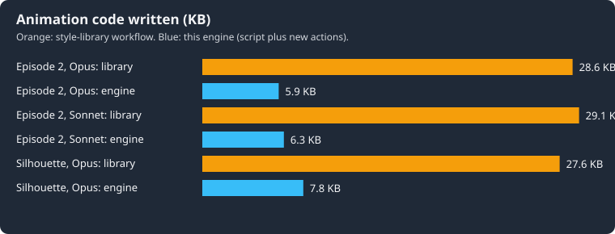

# CharAI evidence: what it costs to make characters, actions and films

This page reports what we measured, including where CharAI lost.

## How this was measured, and the limits

- Each case was run **once**. There are no repeats and no error bars.
- Token figures are the totals each AI agent run reported: all tokens, input and output together. They are not dollars.
- "Price-weighted" counts Claude Sonnet at half of Claude Opus, the ratio of their list prices. Figures are thousands of tokens.
- Times are agent working time.
- The engine agent's token counter reset once. Its per-round figures are therefore approximate, and one round is unmeasured.
- Picture quality was judged from still frames by the supervising model. Motion was judged from strips, not by watching. Lip sync was judged by the project owner by ear: it matches, but is not polished.
- "Lemo" below means the style-library workflow (Lemo-Opuscar, with crayon picture-book and silhouette styles). Its setup was not counted.

## 1. What a character costs

| | Skin file | Tokens | Time |
| --- | --- | --- | --- |
| Before the mannequin: Kai, Opus | 16 KB | not separable from the episode | not separable |
| Before: Kai, Sonnet | 14 KB | not separable | not separable |
| Before: snow girl, Sonnet | 16.9 KB | not separable | not separable |
| After: 6 characters, Sonnet | 1.3 to 2.2 KB | about 41,800 each | about 40 s each |
| After: all 8 including the re-test pair | 1.3 to 2.2 KB | about 41,000 each | |

The agents worked from the documents without reading engine code. All eight pass the skin checker and run, jump and wave. Before the mannequin, character drawing was bundled with other work, so no per-character token figure exists.

## 2. What an action costs

36 actions were written by Claude Sonnet from `docs/ACTIONS.md` alone: about 8,200 tokens and 9 seconds each, 0.4 to 0.7 KB per action. All passed the action checker.

| Rating of the 36 | Good | Acceptable | Poor | Not viewed |
| --- | --- | --- | --- | --- |
| First pass (agents' own verdicts) | 6 | about 14 | 7 | 9 |

Poor ones traced to engine gaps, such as no start state other than standing and no air time. One Claude Opus fix round (93,000 tokens, 12.2 minutes) followed. A Claude Sonnet review then repaired 28 actions (217,112 tokens, 4.8 minutes), rewriting 19. Verdicts after: 14 good, 14 acceptable, from the same agents. The log does not say how the other 8 were rated after the fix.

## 3. What a scene costs

All written by Claude Sonnet from the documents.

| Scene | Length | Script | Tokens | Minutes |
| --- | --- | --- | --- | --- |
| Two characters, moods, 3 own actions | 20 s | 31 lines | 98,844 | 2.4 |
| Talking scene (includes face swaps for two characters) | 15 s | 35 lines | 105,351 | 3.1 |
| Talking scene with voice and sound | 21 s | not stated | 84,578 | 3.6 |
| Hug, handover, scuffle, 3 own paired actions | 20 s | 29 lines | 123,413 | 4.2 |
| Snow Day, scenery, character and acting | 14 s | 0.8 KB acting script | 320,890 | 15.4 |

The paired-action scene was judged weak as a whole, though hug and handover were readable. An Opus fix round followed (98,174 tokens, 11.5 minutes). Snow Day was a film made to match a reference picture, not shipped.

## 4. Against the style-library workflow

### Two 30-second episodes ("Kai")

| Method | Model | Ep 1 tokens | Ep 2 tokens | Both | Minutes | Price-weighted |
| --- | --- | --- | --- | --- | --- | --- |
| Lemo | Opus | 240,515 | 291,853 | 532,368 | 39 | 532 |
| Lemo | Sonnet | 340,175 | 327,027 | 667,202 | 74 | 334 |
| Engine | Opus | 255,604 | 221,729 | 477,333 | 33 | 477 |
| Engine | Sonnet | 203,205 | 221,852 | 425,057 | 25 | 213 |

On Opus, episode 1 cost the engine more tokens (255,604 against 240,515) and one more minute. It won on episode 2 and in total. Episode 2 reused Kai and the lamb in both methods.

New code written for episode 2:

| Run | Creature | Set | Animation | Total |
| --- | --- | --- | --- | --- |
| Lemo, Opus | 12,221 | 9,467 | 28,628 | 50,316 |
| Lemo, Sonnet | 12,281 | 9,698 | 29,109 | 51,088 |
| Engine, Opus | 16,955 | 16,277 | 2,349 script + 3,551 actions | 39,132 |
| Engine, Sonnet | 13,830 | 11,693 | 2,054 script + 4,264 actions | 31,841 |

The engine's creatures and sets were larger; its animation was much smaller.

### Silhouette film ("First Jump", 30 s, both on Opus)

| Measure | Lemo | Engine | Engine against Lemo |
| --- | --- | --- | --- |
| Tokens | 318,987 | 391,611 | +23% |
| Minutes | 24.7 | 35.7 | +44% |
| Tool calls | 65 | 100 | +54% |
| Code, total | 45.2 KB | 35.6 KB | -21% |
| Figures | 13.9 KB | 4.0 KB | -71% |
| Animation | 27.6 KB | 7.8 KB | -72% |
| Sky, water, set | 2.4 KB (9 KB shader reused) | 11.0 KB | +358% |
| Engine changes | 0 | 12.8 KB | |
| Fix rounds | 6 | 5 | |
| Video file | 32.0 MB | 7.9 MB | -75% |

**CharAI lost this test on cost and on looks.** The other workflow's film looked better (richer sky, more varied shots, more natural child proportions) and cost less. The engine's film was clean and on the beat but flatter, with big-headed figures that merge. The project owner also judged the other workflow's motion better at that time.

Afterwards the engine gained motion clips, spring physics for hair, scarf and pack, soft limbs, moods, speech and two-character contact. **The silhouette comparison was not re-run.** We do not claim the gap has closed.

## 5. What the engine cost to build

This is a one-time cost, paid once and shared by every later film.

| Stage | Opus | Sonnet |
| --- | --- | --- |
| Early engine (skeleton, skins, script language) | 875,467 | |
| Snow Day engine upgrade (motion clips, springs) | 446,931 | |
| Stages 0 to 1 (rig rules, mannequin, tools, proofs) | 176,755 | 662,235 |
| Stage 2 (pose language, moods, 44 actions) | 215,883 | 621,937 |
| Stage 3 (faces, speech, proof scene) | 108,591 | 118,018 |
| Windows voice tool and talking scene | | 84,578 |
| Packaging | | 90,929 |
| Stage 4 contact (round unmeasured, 44.5 min) | not measurable | 123,413 |
| Release preparation, stage 4 fix | 98,174 | 120,289 |

Final totals for the first-release build: Sonnet 1,821,399 tokens; Claude Opus at least 599,403 plus the unmeasured round. The first two rows are not in those totals. The Opus figures are differences of a counter that reset once.

**Break-even.** The log works it out only for the early engine (875,467 Opus tokens) against the two Kai episodes:

| Engine instead of Lemo | Saving per episode | Break-even |
| --- | --- | --- |
| Opus instead of Opus | about 27,500 tokens | about 32 episodes |
| Sonnet instead of Opus | about 160 price-weighted thousand | about 6 episodes |
| Sonnet instead of Sonnet | about 60 price-weighted thousand | about 15 episodes |

These break-evens cover the early engine only. The later stages added far more build cost and the log gives no break-even for them. The silhouette test saved nothing.

## 6. What has not been measured

- A film that reuses existing characters with nothing new to draw. This is the engine's best case, and it was never run.
- Anything longer than 30 seconds.
- Quality rated by humans.
- The host snippets for Remotion, HyperFrames and GSAP, and the `src` attribute over http.
- Dollar cost: input and output tokens were not reported separately.
